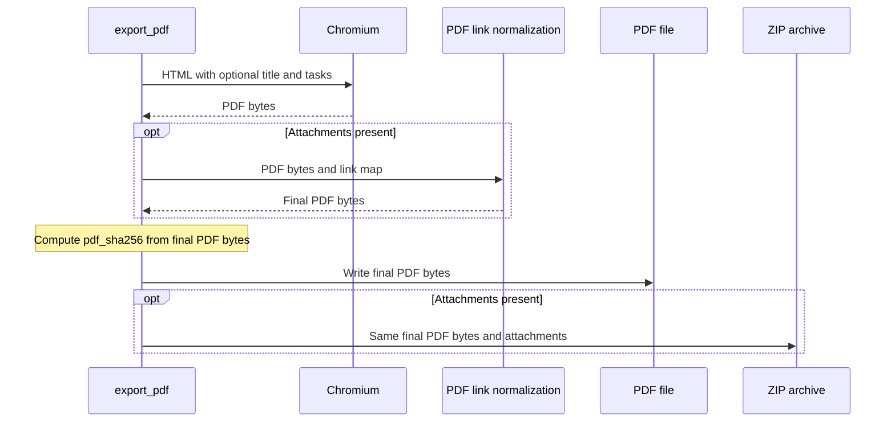

# Design

## Context

Мотивация — в `proposal.md`. Этот документ описывает будущую реализацию черновика, не разрешая apply.

- `homework/server.py:40–48` передаёт два аргумента в `export_pdf` через `asyncio.to_thread`.
- `homework/render.py:85–170` собирает условия и HTML, печатает PDF, затем нормализует ссылки и создаёт ZIP. Вставка перед `sections` в HTML на строке 133 достаточна; отдельный PDF-движок или проход постобработки не нужен.
- CSS задаёт A4, поля 18 мм и основной шрифт 12 pt. Поведение без заголовка должно использовать прежние HTML и CSS.
- `homework/tests/test_export.py:200–220` проверяет точный набор свойств MCP-схемы; `test_extracted_bundle_links_content_and_game_numbering` уже проверяет содержимое ZIP, ссылки и один пункт для 19–21.
- Основная спецификация, README, docstring и skill сейчас прямо требуют отсутствие заголовков. Delta обновляет это правило явным исключением, сохраняя прежние сценарии; основная спецификация при подготовке черновика не меняется.

Design включён из-за согласования двух функций, публичной MCP-схемы и существующего запрета заголовков; архитектура экспорта остаётся прежней.

## Goals / Non-Goals

**Goals:** сохранить старую ветку генерации при пустом заголовке и добавить отдельный текстовый блок при непустом, не вмешиваясь в HTML исходных задач.

**Non-Goals:** новая система шаблонов, пользовательские параметры оформления, метаданные заголовка в ответе или sources, извлечение заголовка из имени файла, автоматическое сочинение заголовка.

## Decisions

### 1. Один необязательный аргумент

Предлагаемый контракт черновика: добавить последним `title: str = ""` в `create_pdf` и `export_pdf`, передать его через имеющийся `to_thread`. Обязательными в MCP остаются только `topic_ids` и `output_path`; старые Python-вызовы также сохраняются. `null` не является строковым заголовком; отдельный nullable-контракт не вводится.

Нормализовать только краевые пробельные символы через `strip()`. Пустой результат означает прежний экспорт без блока заголовка. Альтернатива с новым tool или флагом показа добавляет второй источник управления и не нужна.

### 2. Текстовый блок перед первым пунктом

Непустой заголовок экранировать стандартным `html.escape` и вставить один раз перед уже собранными секциями задач. Предлагаемое оформление по умолчанию: тот же шрифт и размер 12 pt, жирное начертание, выравнивание слева, отступ снизу 8 мм; обычный перенос текста с сохранением внутренних переводов строк. Это фиксированное оформление черновика, не новый параметр API.

Стиль задавать только добавляемому блоку, не менять общие селекторы `p`, `body`, `.task`. Пустая ветка не добавляет ни HTML-блока, ни стиля и сохраняет прежнюю сборку документа. Не вводить повторяющийся колонтитул, отдельную титульную страницу или принудительный разрыв страницы.

Альтернатива с обычным `h1` без явного стиля привносит браузерные отступы и размер. Вставка в первое исходное условие нарушает сохранение оригиналов. Формирование заголовка после печати PDF потребует пересчёта позиций и не подходит.

### 3. Одна версия PDF для отдельного файла и ZIP

Существующий поток уже записывает одни и те же финальные байты PDF на диск и в ZIP. Заголовок формируется до печати; шаги обработки приложений и PDF-ссылок продолжают работать по прежнему плану. `pdf_sha256` автоматически относится к итоговому PDF с заголовком.

Не добавлять заголовок в `tasks`, ответы, `attachment_map` или поля ответа. Он не меняет количество задач, их номера, имена приложений и выбор `result_file`.

### 4. Узкая проверка совместимости

Расширить существующие автономные тесты экспорта, используя `TaskBank` и настоящий Chromium: отсутствие аргумента, пустой и пробельный заголовок, кириллица, символы `<`, `>` и `&`, заголовок один раз в многостраничном PDF. Проверить текст и геометрию первого пункта для веток без заголовка, а не сравнивать PDF побайтово между независимыми печатями: служебные метаданные могут отличаться.

Для проверки прежней вёрстки до изменения реализации зафиксировать на небольшой синтетической задаче исходные страницы, текст и позиции текста в текущем окружении и сравнить после изменения; не создавать общую инфраструктуру визуальных снимков. При заголовке допустимо естественное смещение задач и изменение пагинации.

Параметризовать существующую проверку схемы: `title` присутствует в свойствах с типом string и default `""`, но отсутствует в required. В ZIP-сценарии с блоком 19–21 проверить заголовок извлечённого PDF, неизменность имён приложений и действующие относительные ссылки. Основная команда будущей проверки — `make check` из `homework/`.

## Risks / Trade-offs

- Заголовок меняет доступное место на первой странице → при непустом значении это ожидаемо; отдельно проверить многостраничный PDF и отсутствие обрезки, сохранив общие параметры страницы.
- Символы разметки способны изменить HTML вместо отображения текста → экранировать только заголовок и проверить буквальный текст готового PDF.
- Старый тест MCP фиксирует ровно два свойства → расширить проверку допустимых свойств, сохранив прежний required и старые вызовы.

## Migration Plan

Миграция результатов или данных не требуется. При отдельном разрешении на apply обновить две функции, относящиеся тесты, docstring, README и инструкцию skill; выполнить `make check`. Для загрузки обновлённого MCP и skill перезапустить OpenCode. Старые экспорты не переписывать. Текущий запрос завершается на проверке документов.
