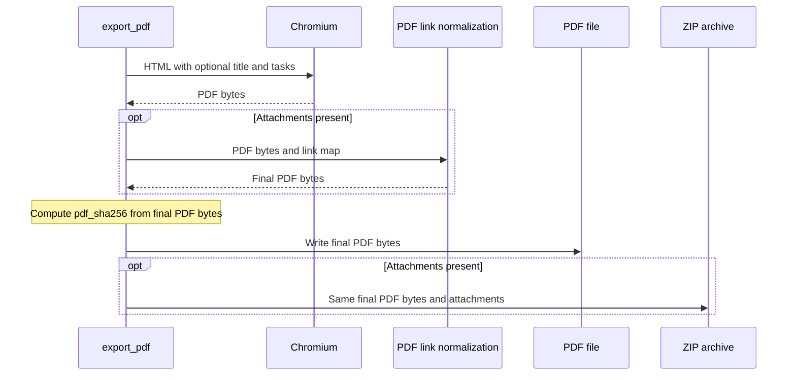

### 3. Одна версия PDF для отдельного файла и ZIP

Существующий поток уже записывает одни и те же финальные байты PDF на диск и в ZIP. Заголовок формируется до печати; шаги обработки приложений и PDF-ссылок продолжают работать по прежнему плану. `pdf_sha256` автоматически относится к итоговому PDF с заголовком.

Не добавлять заголовок в `tasks`, ответы, `attachment_map` или поля ответа. Он не меняет количество задач, их номера, имена приложений и выбор `result_file`.
